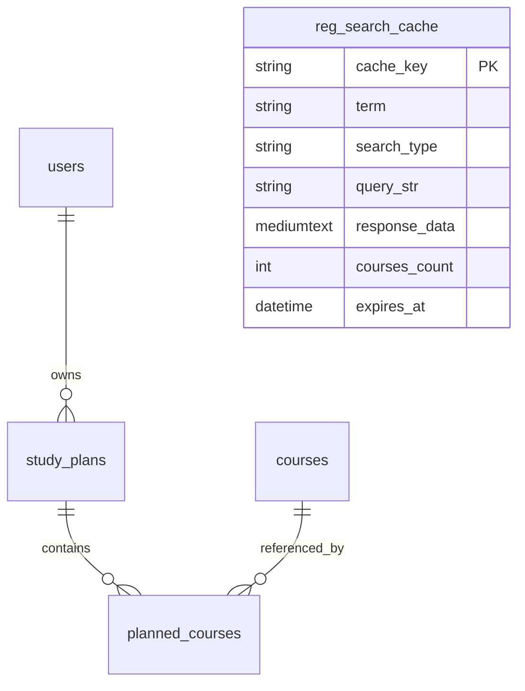

# CMU CS Study Planner (ระบบวางแผนการเรียน วท.บ. วิทยาการคอมพิวเตอร์ มช.)

เว็บแอปพลิเคชันสำหรับนักศึกษาสาขาวิทยาการคอมพิวเตอร์ มหาวิทยาลัยเชียงใหม่ ใช้สำหรับวางแผนการลงทะเบียนเรียนตลอดหลักสูตร 4 ปี (8 เทอม) ช่วยคำนวณเกรดเฉลี่ย (GPA / GPAX) แบบ Real-time ตรวจสอบหน่วยกิตสะสมตามโครงสร้างหลักสูตร TQF และมีระบบค้นหาตารางเรียนสดจากสำนักทะเบียน มช. (REG CMU)

---

## 📌 จุดประสงค์ของโปรเจกต์

ระบบนี้สร้างขึ้นมาแก้ปัญหาเวลาลงทะเบียนเรียนของนักศึกษา เช่น:
1. ไม่แน่ใจว่าวิชาที่เลือกลงไปจะเก็บหน่วยกิตครบตามหมวดไหม (ศึกษาทั่วไป, แกน, เอกบังคับ, เอกเลือก, เลือกเสรี)
2. อยากลองจำลองเกรดล่วงหน้าว่าถ้าได้เกรดเท่านี้ GPA และ GPAX สะสมจะจบที่เท่าไหร่
3. เวลาจะหาวิชาเรียนต้องเปิดเว็บสำนักทะเบียนสลับไปมา หน้านี้เลยดึงข้อมูลเวลาเรียนและ Section จาก REG มช. มาให้ค้นหาและกดเพิ่มเข้าแผนได้ทันที

---

## 🔑 บัญชีสำหรับทดสอบระบบ (Test Accounts)

ระบบเตรียมบัญชีตัวอย่างไว้ให้ทดสอบได้ทันที:

| ประเภทผู้ใช้งาน | Username / รหัสนักศึกษา | Password | สิทธิ์การใช้งาน |
|---|---|---|---|
| **นักศึกษาทั่วไป (Demo)** | `660510001` | `123456` | วางแผนการเรียน, คำนวณเกรด, ค้นหาวิชา, เพิ่มวิชาใหม่ |
| **ผู้ดูแลระบบ (Admin รหัสนักศึกษา)** | `690510692` | `123456` | เข้าหน้า Admin ได้, จัดการผู้ใช้, จัดการรายวิชา, ล้างแคช |
| **ผู้ดูแลระบบ (Direct Admin Login)** | `admin_cs` | `ilovecscmu` | เข้าหน้า `admin.php` ได้โดยตรงผ่านฟอร์มแอดมิน |

> สามารถกดสมัครสมาชิกใหม่ที่หน้า `register.php` ด้วยรหัสนักศึกษาของตัวเองได้เลย ข้อมูลรหัสผ่านจะถูกแฮชด้วย BCRYPT ปลอดภัย

---

## ✨ ฟีเจอร์ทั้งหมดในระบบ

### 1. แดชบอร์ดวางแผนการเรียน 4 ปี (`index.php`)
- แสดงตารางแผนการเรียนแบ่งเป็น 4 ชั้นปี ปีละ 2 เทอม (ทั้งหมด 8 เทอม)
- แต่ละเทอมสามารถกด **ย่อ/ขยาย (Accordion)** ได้อิสระ พร้อมปุ่ม "ขยายทั้งหมด" และ "ย่อทั้งหมด"
- แสดงรหัสวิชา, ชื่อวิชา, หน่วยกิต, Section, วันเวลาเรียน, อาจารย์ผู้สอน และช่องเลือกเกรดที่คาดหวัง
- มีแถบ Progress Bar เช็คความคืบหน้าหน่วยกิตรวม (เป้าหมาย 130 หน่วยกิต) และแยกย่อยตาม 5 หมวดหมู่วิชา
- **ระบบป้องกันการลงวิชาซ้ำ:** ป้องกันไม่ให้ใส่วิชาเดียวกันซ้ำในเทอมเดียวกัน แต่ถ้าจะลงซ้ำเพื่อรีเกรด (Retake) ในคนละเทอม สามารถทำได้ปกติ
- มีปุ่ม "โหลดตัวอย่าง" เพื่อดึงแผนการเรียนมาตรฐานปี 1-4 มาดูเป็นแนวทาง และปุ่ม "รีเซ็ตแผน"
- มีปุ่ม "พิมพ์ / PDF" สำหรับสั่งพิมพ์หรือเซฟเป็นไฟล์ PDF เก็บไว้

### 2. ระบบคำนวณเกรดเฉลี่ยแบบ Real-time (Dynamic GPA Calculator)
- คำนวณ GPA แยกตามแต่ละเทอม
- คำนวณ GPA แยกตามแต่ละชั้นปี
- คำนวณ GPAX สะสมตลอดทั้งหลักสูตร
- วิชาที่ยังไม่ได้ใส่เกรด (เลือกเป็น `-`) จะไม่ถูกนำมาคิดแต้มและไม่นับหน่วยกิต ทำให้เกรดที่แสดงไม่เพี้ยน
- แสดงข้อความเตือนสุภาพเมื่อยังไม่มีการประเมินเกรด แทนการขึ้นค่า `NaN` หรือ `Infinity`

**เกณฑ์แต้มคะแนนที่ใช้คำนวณ:**
- A = 4.0 | B+ = 3.5 | B = 3.0 | C+ = 2.5 | C = 2.0 | D+ = 1.5 | D = 1.0 | F = 0.0

### 3. ระบบค้นหาวิชาจากสำนักทะเบียน มช. สดๆ (`reg-search.php`)
- เนื่องจากหน้าค้นหาของสำนักทะเบียน มช. (`searchcourse.php`) ไม่มี REST/JSON API ทางการให้บุคคลทั่วไปเรียกใช้ ระบบนี้จึงสร้าง **Backend Scraper Proxy** ขึ้นมาทำงานเบื้องหลัง
- ค้นหาได้ 3 รูปแบบ:
  1. ค้นหาจากรหัสวิชา 6 หลัก (เช่น `204100`, `204111`, `206111`)
  2. ค้นหาจากรหัสกลุ่มวิชา 3-4 ตัวแรก (เช่น `204` คอมฯ, `206` แมท, `208` สถิติ, `001` ภาษาอังกฤษ)
  3. ค้นหาจากชื่อวิชา (เช่น `PROGRAMMING`, `INTRO`, `DATA`)
- เลือกรหัสเทอมได้ (เช่น `2/2569`, `1/2569`, `2/2567H`, `1/2567H` *เทอมที่ปิดแล้วของ มช. จะมีตัว H ต่อท้าย*)
- แสดงผลลัพธ์แยกตามรายวิชา มีข้อมูลตารางสอบกลางภาค/ปลายภาค ลิงก์ไปยัง TQF (MIS CMU) และตาราง Section ที่บอกสถานะเปิด/เต็ม, วันเวลาเรียน, ห้องเรียน, อาจารย์, จำนวนที่นั่ง
- **ปุ่ม "นำเข้าระบบ":** หากพบวิชาที่ต้องการ สามารถกดปุ่มนี้เพื่อบันทึกเข้าฐานข้อมูลส่วนกลาง และเลือกปี/เทอมเพื่อเพิ่มเข้าสู่แผนการเรียนได้ทันที
- **ความปลอดภัยของระบบค้นหา:**
  - **SSRF Guard:** ล็อกเป้าหมายเฉพาะโดเมนสำนักทะเบียน มช. ป้องกันการยิงเข้าเครื่องเครือข่ายภายใน
  - **Rate Limiter:** จำกัดการค้นหาไม่เกิน 15 ครั้งต่อนาทีต่อผู้ใช้ เพื่อไม่ให้ไปยิงเซิร์ฟเวอร์ มช. ถี่เกินไป
  - **Smart Database Cache (`reg_search_cache`):** ผลการค้นหาจะถูกบันทึกลงฐานข้อมูล local เก็บไว้ 24 ชั่วโมง ถ้าค้นหาคำเดิมซ้ำจะดึงจากแคชทันที เร็วระดับ 0 ms และไม่สร้างทราฟฟิกไปกวนเซิร์ฟเวอร์ของมหาวิทยาลัย

### 4. ระบบเพิ่มรายวิชาใหม่แบบช่วยกันแชร์ (`create-course.php`)
- นักศึกษาสามารถช่วยกันเพิ่มวิชาเปิดใหม่ หรือวิชาโท/วิชาเลือกเสรีนอกคณะเข้าสู่คลังวิชากลางได้
- เมื่อเพิ่มแล้ว นักศึกษาคนอื่นในระบบจะค้นหาและดึงวิชานั้นไปใส่ในแผนการเรียนของตัวเองได้ทันที

### 5. แผงควบคุมผู้ดูแลระบบ (`admin.php`)
- ระบบจำกัดสิทธิ์ให้เข้าถึงได้เฉพาะ:
  - บัญชีรหัสนักศึกษา **`690510692`**
  - หรือเข้าสู่ระบบโดยตรงด้วย User: **`admin_cs`** / Password: **`ilovecscmu`**
- ถ้าผู้ใช้ทั่วไปหรือคนที่ไม่ได้ล็อกอินพยายามเข้า จะมีหน้าฟอร์มเข้าสู่ระบบแอดมินโดยตรง (พร้อมปุ่มกด Autofill) หรือถ้าเป็นผู้ใช้ทั่วไปจะถูกปฏิเสธการเข้าถึง
- **ความสามารถของ Admin:**
  - **จัดการผู้ใช้งาน (Users):** ดูรายชื่อทั้งหมด, ค้นหาผู้ใช้, เพิ่มบัญชีใหม่, แก้ไขชื่อ, รีเซ็ตรหัสผ่านให้นักศึกษาที่ลืมรหัส, และลบบัญชีผู้ใช้ (มีระบบกันไม่ให้เผลอลบบัญชี Superadmin ตัวเอง)
  - **จัดการกระบวนวิชา (Courses):** ดูคลังวิชาทั้งหมด, กรองตามหมวดหมู่, ค้นหาตามรหัส/ชื่อ/อาจารย์, ดูสถิติว่ามีคนเลือกวิชานี้กี่คน, เพิ่มวิชาใหม่, แก้ไขข้อมูลทุกฟิลด์ผ่าน Modal, และลบวิชา
  - **จัดการแคชสำนักทะเบียน (Cache Management):** ดูตารางประวัติแคชการค้นหา, ดูสถานะ Active/Expired, สั่งล้างแคชเฉพาะที่หมดอายุแล้ว หรือสั่งล้างแคชทั้งหมด (Truncate)
  - **สถิติและสถานะระบบ:** แสดงจำนวนผู้ใช้, จำนวนวิชา, จำนวนวิชาที่ถูกเลือกในแผน, ข้อมูลเซิร์ฟเวอร์ PHP/MySQL

---

## 📂 โครงสร้างไดเรกทอรีและไฟล์ในโปรเจกต์

```text
cs-planer/
├── index.php                 # หน้าหลัก Dashboard แผนการเรียน 4 ปี (คำนวณ GPA/GPAX)
├── login.php                 # หน้าเข้าสู่ระบบ (รองรับทั้งนักศึกษาและ admin_cs)
├── register.php              # หน้าสมัครสมาชิกใหม่
├── logout.php                # ออกจากระบบและเคลียร์ Session
├── admin.php                 # แผงควบคุมผู้ดูแลระบบ (เฉพาะ 690510692 และ admin_cs)
├── reg-search.php            # หน้าค้นหากระบวนวิชาสดจากสำนักทะเบียน มช. (REG CMU)
├── create-course.php         # หน้าเพิ่มวิชาเข้าคลังส่วนกลาง (Crowdsourced Library)
├── setup.php                 # สคริปต์ติดตั้งและเตรียมฐานข้อมูลอัตโนมัติ (คลิกเดียวจบ)
├── CSCMU-LOGO.png            # โลโก้ภาควิชาวิทยาการคอมพิวเตอร์ มช.
├── README.md                 # คู่มือและเอกสารอธิบายระบบทั้งหมด
│
├── config/
│   └── database.php          # การเชื่อมต่อฐานข้อมูล PDO (รองรับ MAMP/XAMPP พอร์ต 3306)
│
├── includes/
│   ├── auth.php              # ฟังก์ชันตรวจสอบสิทธิ์ Session, isLoggedIn(), isAdmin(), requireAdmin()
│   ├── header.php            # แถบเมนูด้านบน (Navbar), Favicon, โลโก้, ปุ่มแอดมิน
│   └── footer.php            # แถบด้านล่างเว็บไซต์ (Footer) และโหลด Script หลัก
│
├── api/
│   ├── courses.php           # API ดึงและค้นหารายวิชาในฐานข้อมูลสำหรับหน้า Dashboard
│   ├── planned-courses.php   # API จัดการวิชาในแผนของนักศึกษา (เพิ่ม, ลบ, โหลดตัวอย่าง)
│   ├── update-grade.php      # API อัปเดตเกรดที่คาดหวังแบบ Real-time
│   ├── reg-courses.php       # API ดึงข้อมูลจาก REG มช. + ทำ Smart Cache + นำเข้าวิชาสู่ระบบ
│   └── admin.php             # API สำหรับหน้า Admin (จัดการ User, วิชา, และล้างแคช)
│
├── assets/
│   ├── css/
│   │   └── style.css         # CSS หลัก ธีม CMU Purple (#682c91) และการจัดหน้า Responsive
│   ├── js/
│   │   └── app.js            # JavaScript ฝั่งหน้าบ้าน (คำนวณ GPA, ดึง API, จัดการ DOM)
│   └── images/
│       └── CSCMU-LOGO.png    # สำเนาไฟล์โลโก้
│
└── database/
    ├── schema.sql            # คำสั่งสร้างตารางทั้ง 5 ตารางในฐานข้อมูล
    ├── sample_data.sql       # ข้อมูลเริ่มต้น: บัญชีตัวอย่าง, บัญชีแอดมิน, รายวิชา TQF (85+ วิชา)
    └── cmu_tqf_courses.sql   # สำรองข้อมูลเฉพาะรายวิชาหลักสูตร TQF
```

---

## 🗄️ โครงสร้างฐานข้อมูล (Database Schema)

ฐานข้อมูลชื่อ `cmu_cs_planner` ประกอบด้วย 5 ตารางหลัก:



1. **`users` (ข้อมูลผู้ใช้งาน)**
   - `id` (INT PK): รหัสผู้ใช้
   - `student_id` (VARCHAR UNIQUE): รหัสนักศึกษา เช่น `660510001`, `690510692`, `admin_cs`
   - `full_name` (VARCHAR): ชื่อ-นามสกุลจริง
   - `password` (VARCHAR): รหัสผ่านที่เข้ารหัสด้วย BCRYPT

2. **`courses` (คลังรายวิชาทั้งหมดในหลักสูตร)**
   - `id` (INT PK): รหัสวิชาในระบบ
   - `course_code` (VARCHAR): รหัสวิชา เช่น `204111`
   - `course_name` (VARCHAR): ชื่อกระบวนวิชา
   - `credits` (INT): จำนวนหน่วยกิต (1-12)
   - `section` (VARCHAR): ตอนเรียน
   - `class_time` (VARCHAR): วันและเวลาเรียน เช่น `TuF 0930-1100`
   - `instructor` (VARCHAR): อาจารย์ผู้สอน
   - `category` (VARCHAR): หมวดหมู่ (ศึกษาทั่วไป, แกน, เอกบังคับ, เอกเลือก, เลือกเสรี)
   - `description` (TEXT): คำอธิบายรายวิชา

3. **`study_plans` (แผนการเรียนของนักศึกษาแต่ละคน)**
   - `id` (INT PK): รหัสแผน
   - `user_id` (INT FK -> users.id): ผู้ครอบครองแผน (CASCADE DELETE)
   - `student_id` (VARCHAR): รหัสนักศึกษา
   - `student_name` (VARCHAR): ชื่อนักศึกษา
   - `title` (VARCHAR): ชื่อแผน

4. **`planned_courses` (วิชาที่เลือกใส่ในแต่ละเทอม)**
   - `id` (INT PK): รหัสรายการ
   - `plan_id` (INT FK -> study_plans.id): แผนที่สังกัด (CASCADE DELETE)
   - `course_id` (INT FK -> courses.id): รหัสวิชาที่เลือก (CASCADE DELETE)
   - `year` (TINYINT): ชั้นปี (1-4)
   - `semester` (TINYINT): ภาคการศึกษา (1-2)
   - `expected_grade` (VARCHAR): เกรดที่คาดว่าจะได้รับ (A, B+, B, C+, C, D+, D, F หรือ NULL)
   - *UNIQUE KEY (`plan_id`, `course_id`, `year`, `semester`)* ป้องกันการเพิ่มวิชาเดิมซ้ำในเทอมเดียวกัน

5. **`reg_search_cache` (แคชผลการค้นหาจากสำนักทะเบียน มช.)**
   - `id` (INT PK)
   - `cache_key` (VARCHAR UNIQUE): MD5 Hash ของ `term:type:query`
   - `term` (VARCHAR): ภาคการศึกษา เช่น `2/2567H`, `2/2569`
   - `search_type` (VARCHAR): `code`, `group`, หรือ `title`
   - `query_str` (VARCHAR): คำค้นหา
   - `response_data` (MEDIUMTEXT): ข้อมูล JSON ของวิชาและ Section ทั้งหมดที่ดึงมาได้
   - `courses_count` (INT): จำนวนวิชาที่พบ
   - `created_at` (DATETIME): เวลาที่แคชถูกสร้าง
   - `expires_at` (DATETIME): เวลาหมดอายุ (ตั้งไว้ 24 ชั่วโมงหลังจากสร้าง)

---

## 🛠️ รายละเอียดทางเทคนิค (Tech Stack)

- **Backend:** PHP 8.0+ (ทดสอบบน PHP 8.3.1 MAMP) ใช้ PDO Prepared Statements 100% ป้องกัน SQL Injection
- **Database:** MySQL 5.7+ / MariaDB (InnoDB, utf8mb4_unicode_ci)
- **Frontend:** Vanilla JavaScript (ES6+ Fetch API, Async/Await) ไม่พึ่งพาไลบรารีขนาดใหญ่
- **UI & Styling:** Bootstrap 5.3 + Bootstrap Icons + ฟอนต์ภาษาไทย **Prompt** จาก Google Fonts
- **Branding:** โลโก้ทางการ `CSCMU-LOGO.png` ปรับสไตล์เป็น Favicon และ Navbar Brand ทุกหน้า

---

## 🚀 วิธีการติดตั้งและรันโปรเจกต์ (Step-by-Step)

### 1. การเตรียมสภาพแวดล้อม
- ติดตั้ง **MAMP** หรือ **XAMPP** บนเครื่อง
- นำโฟลเดอร์โปรเจกต์ `cs-planer` ไปวางไว้ที่:
  - **MAMP (Windows):** `C:\MAMP\htdocs\cs-planer`
  - **XAMPP (Windows):** `C:\xampp\htdocs\cs-planer`

### 2. ตรวจสอบการเชื่อมต่อฐานข้อมูล
ไฟล์คอนฟิกอยู่ที่ [`config/database.php`](config/database.php):
```php
$host = getenv('DB_HOST') ?: '127.0.0.1';
$port = getenv('DB_PORT') ?: '3306';
$dbname = getenv('DB_NAME') ?: 'cmu_cs_planner';
$user = getenv('DB_USER') ?: 'root';
$pass = getenv('DB_PASS') !== false ? getenv('DB_PASS') : 'root'; // MAMP ใช้ 'root', XAMPP ใช้ ''
```
ระบบมี Fallback อัตโนมัติ: ถ้าเชื่อมต่อด้วยพาสเวิร์ด `root` ไม่ผ่าน จะลองเชื่อมต่อแบบไม่มีพาสเวิร์ด (สำหรับ XAMPP) ให้เอง

### 3. รันสคริปต์สร้างฐานข้อมูล (1-Click Setup)
เปิดเบราว์เซอร์แล้วไปที่:
```url
http://localhost/cs-planer/setup.php
```
สคริปต์นี้จะ:
1. สร้างฐานข้อมูล `cmu_cs_planner` ให้อัตโนมัติถ้ายังไม่มี
2. นำเข้าตารางทั้งหมดจาก `database/schema.sql`
3. นำเข้าข้อมูลรายวิชาตั้งต้น TQF 85 วิชา และบัญชีผู้ใช้เริ่มต้นจาก `database/sample_data.sql`
4. แสดงผลลัพธ์ว่าติดตั้งสำเร็จพร้อมปุ่มเข้าใช้งานทันที

### 4. เริ่มใช้งาน
- **หน้าหลัก (Dashboard):** `http://localhost/cs-planer/index.php`
- **หน้าเข้าสู่ระบบ:** `http://localhost/cs-planer/login.php`
- **หน้าค้นหาวิชาจาก REG:** `http://localhost/cs-planer/reg-search.php`
- **หน้าแอดมิน:** `http://localhost/cs-planer/admin.php` *(ล็อกอินด้วย `admin_cs` / `ilovecscmu` หรือ `690510692`)*

---

## 📡 สรุป API Endpoints (RESTful JSON)

| Method | Endpoint | Action / พารามิเตอร์ | คำอธิบาย |
|---|---|---|---|
| `GET` | `/api/courses.php` | `?search=...&category=...` | ค้นหารายวิชาในคลังข้อมูลส่วนกลาง |
| `POST` | `/api/courses.php` | Body JSON ข้อมูลวิชา | บันทึกรายวิชาใหม่เข้าคลังกลาง (Crowdsource) |
| `GET` | `/api/planned-courses.php` | - | ดึงรายวิชาทั้งหมดในแผนการเรียนของผู้ใช้ปัจจุบัน |
| `POST` | `/api/planned-courses.php` | `course_id, year, semester` | เพิ่มรายวิชาลงในแผนการเรียน |
| `DELETE` | `/api/planned-courses.php` | `?id=...` หรือ `?action=clear_all` | ลบวิชาออกจากแผน หรือล้างแผนทั้งหมด |
| `POST` | `/api/planned-courses.php` | `action: load_sample` | โหลดแผนการเรียนตัวอย่าง 4 ปีเข้าสู่บัญชี |
| `POST` | `/api/update-grade.php` | `planned_course_id, grade` | บันทึกเกรดที่คาดหมายแบบ Real-time |
| `GET` | `/api/reg-courses.php` | `?term=2/2567H&type=code&q=204100` | ค้นหาวิชาสดจาก REG มช. พร้อมอ่านจากแคช |
| `POST` | `/api/reg-courses.php?action=import` | Body JSON ข้อมูลวิชาจาก REG | นำเข้าวิชาจาก REG สู่ระบบ และเพิ่มเข้าแผนได้ทันที |
| `GET/POST` | `/api/admin.php` | `action: get_users, create_user, update_user, reset_password, delete_user` | จัดการผู้ใช้งานในระบบ (เฉพาะ Admin) |
| `GET/POST` | `/api/admin.php` | `action: get_courses, create_course, update_course, delete_course` | จัดการคลังรายวิชาในระบบ (เฉพาะ Admin) |
| `GET/POST` | `/api/admin.php` | `action: get_stats, get_caches, clear_cache` | ดูสถิติระบบและบริหารจัดการแคช REG |

---

## 💡 บันทึกข้อสังเกตเพิ่มเติมสำหรับนักพัฒนา (Notes)

1. **เรื่องรหัสภาคการศึกษาของสำนักทะเบียน มช. (`tterm`):**
   - เทอมในอดีตหรือเทอมที่ปิดประมวลผลไปแล้ว ทางสำนักทะเบียนฯ จะเติมตัวอักษร **`H`** ต่อท้าย เช่น `2/2567H`, `1/2567H`, `2/2566H`
   - เทอมปัจจุบันหรือเทอมอนาคตจะไม่มีตัว H เช่น `1/2568`, `2/2569`
   - ในหน้า `reg-search.php` ได้เตรียมตัวเลือกที่ใส่ `H` ให้อัตโนมัติแล้ว ทำให้ค้นหาข้อมูลจริงย้อนหลังได้อย่างแม่นยำ
2. **เรื่องข้อกำหนด PDPA:**
   - ระบบของสำนักทะเบียน มช. ซ่อนรายชื่อนักศึกษาที่ลงทะเบียนไว้หลังระบบ CMU OAuth แต่ข้อมูลพื้นฐานที่จำเป็นต่อการวางแผนเรียน (ชื่อวิชา, Section, เวลาเรียน, ห้องเรียน, อาจารย์, จำนวนที่นั่ง) สามารถดึงมาแสดงได้ตามปกติ
3. **การทำงานของ Smart Cache:**
   - หากสำนักทะเบียน มช. มีการปรับเปลี่ยนตารางเรียน และต้องการให้ระบบดึงข้อมูลล่าสุดทันที แอดมินสามารถเข้าไปที่หน้า `admin.php` -> เมนู **"แคชและระบบ"** -> กด **"ล้างแคชทั้งหมด"** ได้ตลอดเวลา

---

*จัดทำโดยนักศึกษาสาขาวิทยาการคอมพิวเตอร์ มหาวิทยาลัยเชียงใหม่ (CS CMU)*
